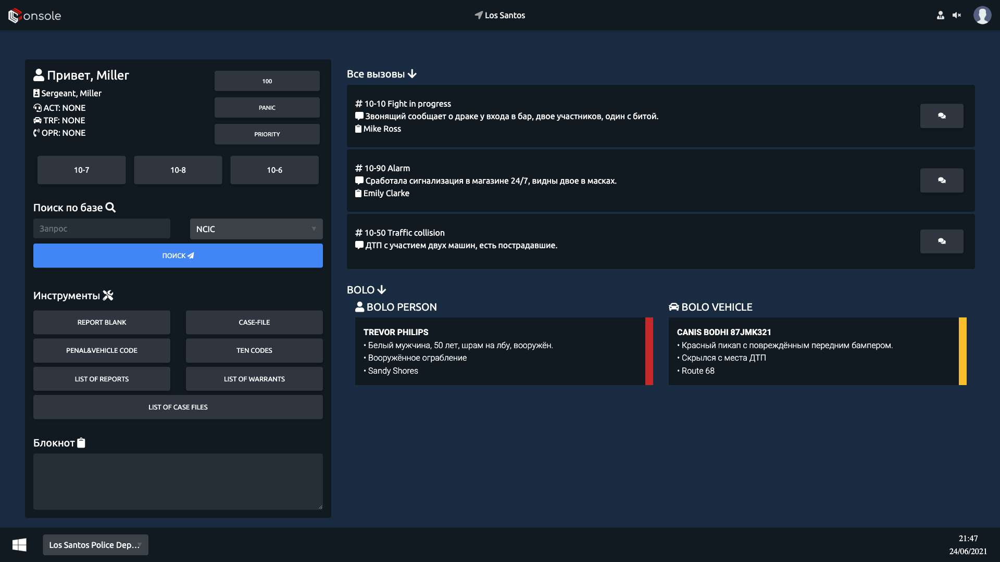
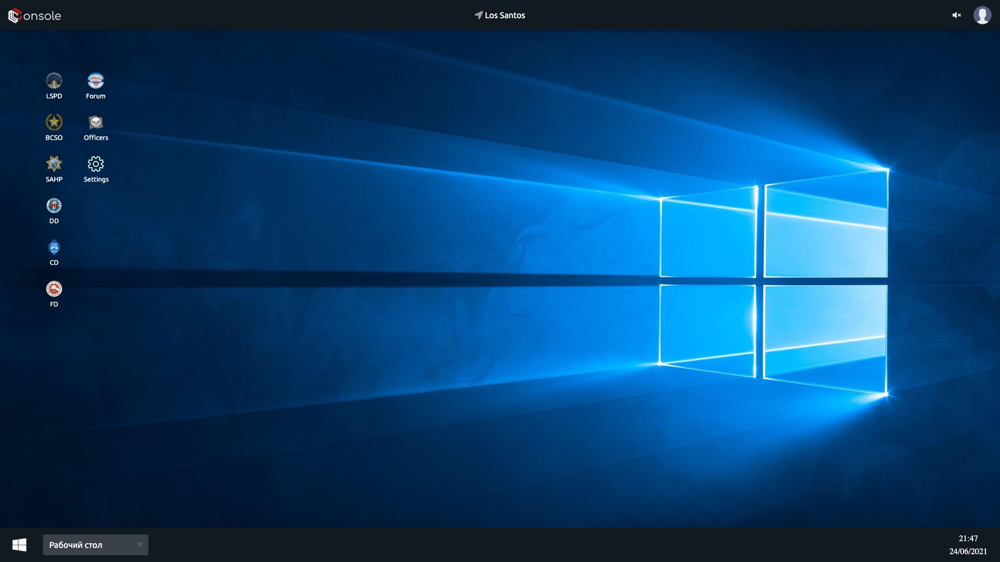
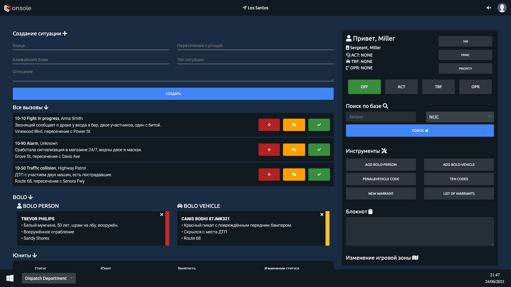
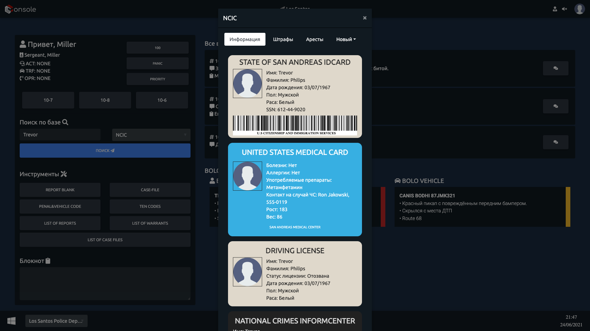
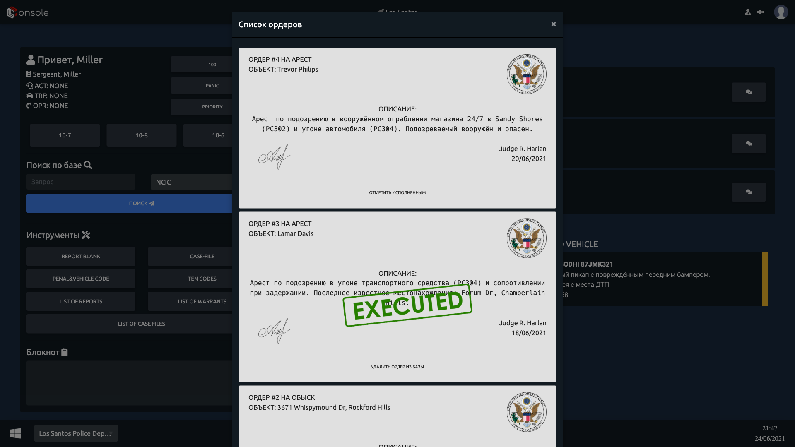
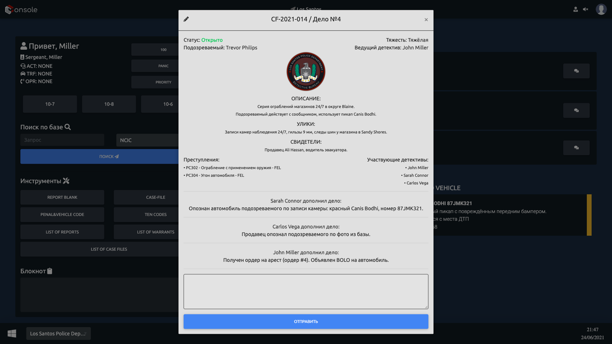
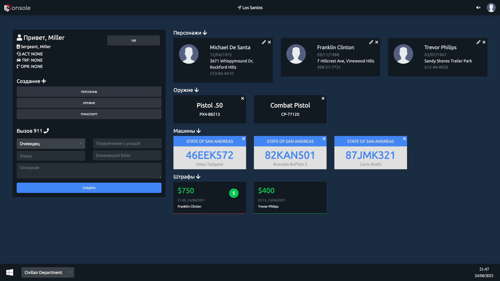

# Console

A CAD/MDT (Computer Aided Dispatch / Mobile Data Terminal) web system for a GTA roleplay server: a dispatcher workstation, an in-car terminal for patrol units and a database of civilian characters. Built in 2020 for the Southland project and used in production by a live community. The interface is in Russian.



## Screenshots

| | |
|---|---|
|  Desktop with department selection |  Dispatch (CAD) |
|  NCIC database lookup |  Warrants |
|  Case file |  Civilian side |

## Features

- **Dispatch (CAD)**: calls, attaching units to calls, real-time unit statuses, panic, priority and Signal 100 buttons.
- **MDT**: NCIC/DMV lookups, BOLOs, citations, arrests, warrants with signing and execution, case files with comments, report forms.
- **Civilian side**: characters with photos, medical records, vehicles and weapons; paying citations.
- **Admin**: departments and the area of play (AOP).
- **Game integration**: the game server can poll an API for the current area of play and the Signal 100 state.
- **Forum login**: sign-in uses the IPS4 forum session, and permissions come from the user's forum groups.
- **Real time**: updates go through a WebSocket server. The PHP backend publishes events and clients receive them without reloading.

## Stack

- **Web app:** PHP 7, MySQL ([RedBeanPHP](https://redbeanphp.com/)), [Twig](https://twig.symfony.com/), jQuery, MDBootstrap.
- **Real-time server:** Node.js, [ws](https://github.com/websockets/ws), Sequelize.

## Structure

```
console.sql            database schema
web/                   web app (PHP)
  index.php            routes
  system/
    config.php         settings (databases, forum, WebSocket)
    api/               JSON endpoints: characters, citations, warrants, case files…
    views/             Twig templates and page handlers
    libraries/         router, RedBeanPHP, WebSocket client
  assets/              styles and client-side JS
websocket/             real-time server (Node.js)
  main.js              event handlers: calls, units, BOLOs…
  db.js                Sequelize models
```

## Running

1. Import `console.sql` into MySQL.
2. **WebSocket server:** in `websocket/`, copy `.env.example` to `.env` and fill it in, then run `yarn install` and `yarn start`.
3. **Web app:** fill in `web/system/config.php`: credentials for the CAD and IPS4 forum databases, `dir_prefix`, `forum_root` and the WebSocket settings (`ws_host`, `ws_port`, `ws_ssl` for PHP, `ws_public_url` for the browser, and `ws_server_token`, which must match `SERVER_TOKEN` in `.env`). Then run `composer install` in `web/`.
4. Serve `web/` with Apache and `mod_rewrite`. `RewriteBase` in `.htaccess` must match `dir_prefix`.
